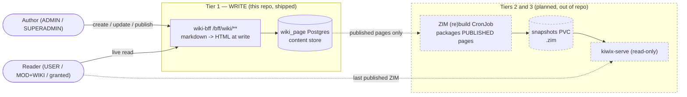
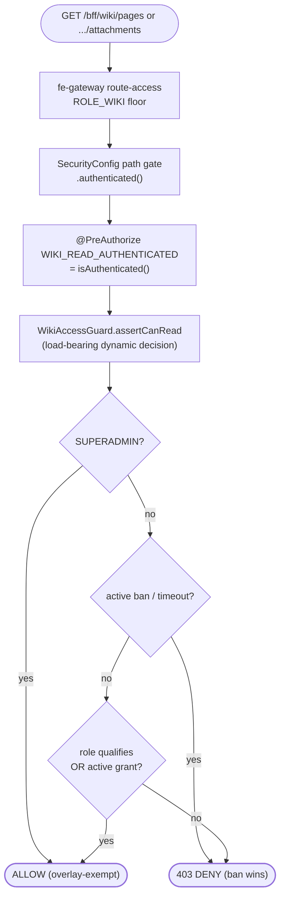
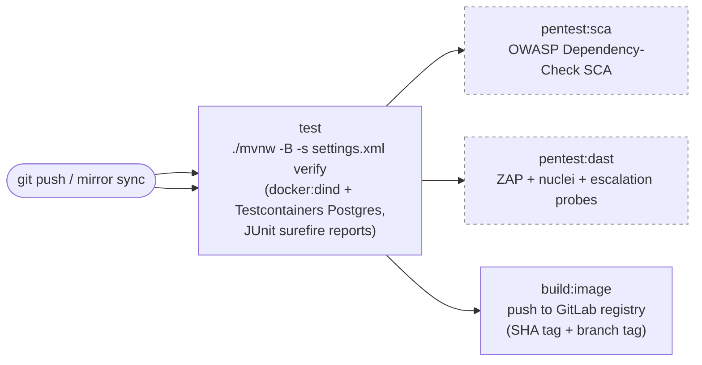

# hugmesh-wiki-bff-api

`hugmesh-wiki-bff-api` is the **write-path backend-for-frontend (BFF)** for the optional
Wiki feature of the [HugMesh](https://github.com/hugmesh) platform. It owns the
**writable Postgres content store** that wiki authors write to, enforces role-gated read
and edit access, and renders Markdown to HTML at save time. That rendered HTML is the
**source of truth** that a (planned) Tier 2 ZIM rebuild job packages for `kiwix-serve` to
serve to readers — see [Three-tier architecture](#three-tier-architecture-write-path-vs-kiwixs-read-only-serving)
below.

It follows the same conventions as the platform's other backend-for-frontend services —
scaffolded from [`hugmesh-forum-bff-api`](https://github.com/hugmesh/hugmesh-forum-bff-api)
(Java 25 / Spring WebFlux / R2DBC Postgres / Liquibase / Casdoor JWT resource server / the
canonical `CasdoorAuthorities` converter + `DomainRegistry`/`DomainScope`/`Roles`
multi-brand spine), and built GraalVM-native capable. The security/tenancy spine is now
sourced from the shared [`hugmesh-commons`](https://github.com/hugmesh/hugmesh-commons)
library — see [Shared commons library](#shared-commons-library-hugmesh-parent--hugmesh-commons)
— while the per-repo `PrincipalDomain` scope resolver stays local to this service.

> **State legend** — ✅ **shipped** (merged to `main`) · 🚧 **in progress** (code on an open
> branch/PR, not yet merged) · 🔭 **planned** (designed, no code yet). Everything below is
> ✅ shipped unless tagged otherwise; unbuilt work lives in
> [Roadmap](#roadmap--out-of-repo).

## Current State

- **DEPLOYING OR TURNING MULTI-BRAND ON? Read the
  [cut-over runbook](#cut-over-set-app_tenancy_issuers-and-redeploy--the-re-stamp-derives-its-own-target)
  first — it is TWO environment variables, not one.** `APP_TENANCY_ISSUERS` performs the
  cut-over; `SPRING_LIQUIBASE_PARAMETERS_WIKI_RESTAMP_TARGET_DOMAIN` is a **permanent pin**
  that must be set afterwards and never removed, because from the armed boot onwards a boot
  that publishes no parameter fails startup on a checksum error that does not name the
  config change (decision 31, operator 2026-09-17). Leaving `APP_TENANCY_ISSUERS` unset is
  a supported, deliberate state, not an unfinished one (decision 30, same date).
- **Dependency baseline:** Spring Boot **4.0.7** / Spring Cloud **2025.1.2**, **Java 25
  LTS** (`eclipse-temurin:25`), on the shared Maven artifacts
  `net.hugmesh:hugmesh-parent:2.8.0` ([parent POM](https://github.com/hugmesh/hugmesh-parent))
  and `net.hugmesh:hugmesh-commons:2.1.0` (shared security/tenancy,
  `net.hugmesh.commons.*`), with Testcontainers **2.0.5** in the test path. The suite
  holds **400** `@Test` methods (counted from source on 2026-10-07, not run for this
  edit) and runs against a real Postgres via Testcontainers rather than an in-memory
  substitute.
- **Place in the platform auth model.** This BFF is a **pure Casdoor-JWT OAuth2 resource
  server**. The browser only ever holds an **opaque `bff_`-prefixed session** (issued and
  refreshed by `user-bff`, which performs the Casdoor OIDC code→token exchange) — the user
  never sees a JWT. The **fe-gateway** runs a pre-security exchange filter that swaps the
  `bff_` session for the internal custody JWT **before** this service sees the request, so
  this resource server's JWT validation and role gate run exactly as documented below. The
  shared [`hugmesh-auth-core`](https://github.com/hugmesh/hugmesh-auth-core) library
  (account/session/MFA/Casdoor-admin) is consumed only by `user-bff` and `admin-bff` — it
  does not touch this repo, and login/account/session logic never lives here.
- **Authorization is gateway-fronted + locally re-checked.** The gateway enforces the
  data-driven `gateway_route_access` floor (`ROLE_WIKI`); this service still does its own
  defence-in-depth path gate + method `@PreAuthorize` + the load-bearing
  `WikiAccessGuard` overlay decision (see below). An MFA step-up check on the admin and
  superadmin paths is wired but off (`app.mfa.enabled`, default `false`).
- **Data access** is Spring Data R2DBC reactive repositories, per the platform's
  data-access convention. Derived finders cover what they can; every other statement is a
  `static final String` bound to `@Query`. There is no `DatabaseClient` and no inline SQL
  in a method body.
- **CI runs on GitLab.** The GitHub repo is pull-mirrored into the platform's in-cluster
  GitLab instance, which runs the pipeline described in
  [CI / security pipeline](#ci--security-pipeline). A manual GitHub Actions workflow
  (`release.yml`) builds the image and pushes it to GHCR. The cluster manifests in
  `hugmesh-generator` set `seLinuxOptions` on the pod, enable mTLS (`SSL_ENABLED=true`,
  `SSL_CLIENT_AUTH=need`) and give the database `scram-sha-256` auth.

## Three-tier architecture (write path vs. Kiwix's read-only serving)

Wiki content has a **write side** and a **read side** with different operational needs:
authors need a live, versioned, access-controlled store; readers need something that stays
up even if the write-side service is down, and `kiwix-serve` — the offline-first reader
this platform serves wiki pages through — has no concept of authentication of its own.
Splitting the two into tiers resolves that: only **Tier 1** lives in this repo and is
shipped. Tiers 2 and 3 are 🔭 planned infrastructure work outside this repo (see
[Roadmap](#roadmap--out-of-repo)). The publish-state columns already on `main` are the
handoff point: only pages with `is_published=true` get packaged by the future ZIM build.



| Tier | What | Owner | State |
| --- | --- | --- | --- |
| **1 — WRITE** | `wiki_page` Postgres content store (markdown authored, HTML rendered at write). Versioned, audited, per-domain. | **this repo** | ✅ shipped |
| **2 — (RE)BUILD** | a CronJob renders the store → packages a ZIM (zim-tools, multi-arch) to a snapshots PVC | out of repo | 🔭 planned |
| **3 — READ** | `kiwix-serve` mounts the PVC read-only and serves it (never the write path) | out of repo | 🔭 planned |

The tiers fail **independently**: a `kiwix-serve` outage never blocks an author from
editing; a BFF outage leaves readers serving from the last successfully published ZIM.

## What this service does today

The shipped surface is well beyond a skeleton. The content store, Markdown renderer, live
grant/timeout/ban access overlay, per-page attachments, draft→published lifecycle, and
audit trail are all on `main`.

- **Liquibase schema** (`db.changelog-master.xml` includes all seven changelog files):
  - `001` — `wiki_page` (`id` varchar PK holding a UUID string, `domain` NOT NULL, `slug`, `title`,
    `content_markdown`, `content_html`, `author_subject`, `version`, `created_at`,
    `updated_at`, **UNIQUE(domain, slug)**).
  - `002` — `wiki_attachment` (`page_id` FK ON DELETE CASCADE, `filename`, `mime_type`,
    `data` BYTEA; `domain` denormalised for scoping).
  - `003` — `wiki_audit_log` (this BFF's own content-edit trail; domain-scoped).
  - `004` — `wiki_access` (the grant/timeout/ban OVERLAY desired-state: `state`
    active→revoked rows are never hard-deleted, so history is auditable; `expires_at` NULL
    = permanent, future = a timeout that auto-restores on expiry; PARTIAL UNIQUE on
    `(domain, user_subject, access_type) WHERE state='active'`, domain-scoped).
  - `005` — published-state columns on `wiki_page` (`is_published` NOT NULL DEFAULT false,
    `published_at`).
  - `006` — **DB-generated UUID primary keys** (a platform-wide convention): installs
    `pgcrypto` and adds a `(gen_random_uuid())::text` column DEFAULT to every PK
    (`wiki_page` / `wiki_attachment` / `wiki_audit_log` / `wiki_access`), so the database —
    not the app — mints the id; the repositories INSERT without an id and read it back via
    `RETURNING id`.
  - `007` — the multi-brand cut-over re-stamp (data only, no DDL). It stays `PENDING`
    until armed; see the
    [cut-over runbook](#cut-over-set-app_tenancy_issuers-and-redeploy--the-re-stamp-derives-its-own-target).
- **R2DBC repositories** — domain-scoped reads, DB-generated-UUID inserts (INSERT without
  an id, `RETURNING id`), and the **version-guarded conditional UPDATE** (optimistic
  concurrency).
- **Casdoor JWT resource server** — the canonical converter (reserved-prefix injection
  guard + issuer-derived `DOMAIN_<x>` + fail-closed domain scope), single- and (opt-in)
  multi-issuer.
- **Markdown → HTML at write** (CommonMark + GFM tables; raw HTML in the source is
  escaped, `MarkdownRenderer` sets `escapeHtml(true)`). It does not set `sanitizeUrls`, so
  link targets are not filtered.
- **`WikiController`** — read (list/get) + edit (create/update) + publish + **delete**, all
  domain-scoped, author tracked from the JWT subject.
- **`WikiAttachmentController`** — per-page binary attachments: upload, download, list,
  delete.
- **`WikiAccessController` + `WikiAccessGuard`** — the grant/timeout/ban overlay, enforced
  at request time on every read.
- **OpenAPI / springdoc** at `/v3/api-docs` — the source for the paired
  [`hugmesh-wiki-ui`](https://github.com/hugmesh/hugmesh-wiki-ui) (✅ shipped:
  ng-openapi-gen typed client, Playwright/BDD e2e harness, Dockerfile+nginx, CI pipeline).
  The UI's `gen:spec` script copies this repo's committed
  `src/main/resources/openapi/openapi.json`. `OpenApiSpecDumpTest` fails when that file
  differs from the live spec; refresh it with `-Dopenapi.spec.write=true`.

### Publish lifecycle

A page is created in **DRAFT** (`is_published=false`). An explicit
`POST /bff/wiki/admin/pages/{slug}/publish` flips `is_published` and stamps `published_at`;
both are recorded in the audit log. The future ZIM (re)build (🔭 planned) will package
**only published pages** and use `published_at` to detect pages republished since the last
build.

## Role model (platform cascade SUPERADMIN > ADMIN > MOD > USER)

```
WIKI_READ   = hasRole('ADMIN') or hasRole('SUPERADMIN') or (hasRole('MOD') and hasRole('WIKI'))
WIKI_WRITE  = hasRole('ADMIN') or hasRole('SUPERADMIN')
WIKI_MANAGE = hasRole('SUPERADMIN')
```

**Defence in depth** runs in layers: the fe-gateway route-access (data-driven
`gateway_route_access`) enforces the `ROLE_WIKI` floor; `SecurityConfig` gates the paths
(`/bff/wiki/superadmin/**` SUPERADMIN, `/bff/wiki/admin/**` ADMIN|SUPERADMIN, the rest
`.authenticated()`); and the controllers re-check at the method level via `@PreAuthorize`.

**MFA step-up is wired and ships dark.** `SecurityConfig.stepUp` wraps the two privileged
path groups (`/bff/wiki/superadmin/**` and `/bff/wiki/admin/**`). While `app.mfa.enabled`
is `false` (the default) the wrapper changes nothing. Once it is `true`, those paths also
demand the `MFA_SATISFIED` marker, which the shared converter derives from a fresh
`mfa_satisfied_at` claim (`app.mfa.freshness-window`, default `600000` ms). The read paths
are not step-up gated. `MfaStepUpPathGateSliceTest` covers it.

The **write/manage** endpoints use **static SpEL** composites at the method level
(`WIKI_WRITE` = ADMIN|SUPERADMIN, `WIKI_MANAGE` = SUPERADMIN). The role hierarchy
(`ROLE_SUPERADMIN > ROLE_ADMIN`, `ROLE_SUPERADMIN > ROLE_MOD`, `ROLE_SUPERADMIN >
ROLE_USER`) means a cross-domain SUPERADMIN can reach ADMIN-gated write endpoints without
being listed explicitly. ADMIN and MOD are siblings: neither implies the other.

The **read** endpoints are different. Their `@PreAuthorize` gate is
`WIKI_READ_AUTHENTICATED = "isAuthenticated()"` — deliberately weaker than a static
`WIKI_READ` check, because a static check would deny a plain USER who holds a grant before
the overlay could be consulted. The load-bearing read decision is therefore made
**programmatically** inside `WikiAccessGuard.assertCanRead(auth)`, which evaluates: the
`WIKI_READ` role composite **OR** an active grant, **AND NOT** an active ban or timeout,
with **SUPERADMIN always exempt**. A denied request never reaches the content store — the
repository call is wrapped in `Mono.defer` and only executed if the guard allows it.

### Grant / timeout / ban overlay (`wiki_access`)

The `wiki_access` table sits on top of the role cascade and is the sole source of truth for
per-principal read overrides:

- **grant / timeout / ban / restore** are `WIKI_WRITE` operations served under
  `/bff/wiki/admin/access/**`. A scoped **ADMIN** always writes within their own
  issuer-derived brand (a `targetDomain` body field, if sent, is inert). A **SUPERADMIN**
  has a `null` scope and so cannot derive the victim's brand from its own token;
  `WikiAccessService.writeDomain` resolves it from the configuration instead, so the row
  lands where `WikiAccessGuard`'s read actually looks. The whole decision, exhaustively:

  | `app.tenancy.issuers` | a USER resolves | SUPERADMIN `targetDomain` | row is stamped |
  | --- | --- | --- | --- |
  | unset (back-compat single-issuer) | `default` | anything — **inert** | `default` |
  | exactly one pair, e.g. `https://id.acme=acme` | `acme` | absent or blank | `acme` |
  | exactly one pair | `acme` | `acme` | `acme` |
  | exactly one pair | `acme` | any other brand | **400** |
  | two or more pairs | per-issuer | a known brand | that brand |
  | two or more pairs | per-issuer | absent or unknown | **400** |

  The 2+ row closed a real gap (fixed in #39): a SUPERADMIN cross-brand ban used to be
  stamped `default` while the read guard queried the victim's own brand, so the ban
  silently never took effect. The **exactly-one-pair** rows closed the same gap at the one
  size #39 left open (fixed under issue #21 / operator decision 26): one configured pair is
  a real brand, not back-compat, so a SUPERADMIN write is stamped with it instead of the
  inert `default`, and a `targetDomain` naming a brand this deployment does not have is now
  a loud `400` instead of a silently discarded field. **Back-compat is untouched**: with
  `app.tenancy.issuers` empty every principal genuinely is `default`, so the stamp already
  matched the guard and `targetDomain` stays inert there — that configuration cannot see a
  400 it did not see before.

  > **Upgrading a deployment that already configures exactly one brand?** Nothing a caller
  > sends has to change, but three things change on the server. (1) A SUPERADMIN
  > grant/timeout/ban that previously returned `200` and did nothing now actually takes
  > effect — if anyone has been "banning" users on this deployment and wondering why they
  > could still read, those bans start biting. (2) A SUPERADMIN write naming some *other*
  > brand now gets a `400`. (3) Rows already written before the upgrade are still stamped
  > `default` and are still inert; re-issue those grants/bans, or run the 007 re-stamp
  > (which moves `wiki_access.domain` too) as part of the cut-over. A SUPERADMIN's
  > `revoke`, `list-active` and `history` are unscoped and can already see the old rows —
  > but note that `revoke` clears **one row per call**: unscoped it resolves through
  > `findFirstByUserSubjectAndAccessTypeAndStateOrderByCreatedAtDescIdAsc`, i.e. the NEWEST
  > active row of that type in any brand. So where a stale `default` row and a new
  > brand-stamped row coexist, the first call clears the new one and a second call is needed
  > for the stale one. They do coexist rather than collide: `uq_wiki_access_active`
  > (changelog 004) is a partial unique on `(domain, user_subject, access_type)` with
  > `domain` IN the key, so the post-upgrade insert cannot trip a constraint on the old row.
  > The leftover `default` row is inert for a branded principal, so this is tidy-up, not a
  > correctness risk.
- **list-active / history** are `WIKI_MANAGE` operations (SUPERADMIN only), served under
  `/bff/wiki/superadmin/access`.
- **The target-brand catalogue** (`GET /bff/wiki/superadmin/brands`, `WIKI_MANAGE`) serves
  what the console needs to offer a real PICKER for that `targetDomain` instead of free
  text (hugmesh-wiki-ui#3). It answers three separate questions and they are not
  interchangeable:
  - `brands` — every value this bff will **accept** as a `targetDomain`. Built by running
    `DomainRegistry.knownDomains()` through `DomainRegistry.isKnownDomain`, the same
    predicate `WikiAccessService.writeDomain` validates with, so a listed brand is
    accepted by construction and the always-rejected sentinels (`default`, blank) cannot
    appear. Sorted, so the rendered order does not drift with an env-var edit.
  - `launchDomain` — the domain this wiki is **launched on**, from the same
    `WikiLaunchDomain` derivation the 007 re-stamp target uses (so the console and the
    migration can never disagree), falling back to `hugmesh`. It is **not necessarily a
    member of `brands`**: with 2+ brands there is no single launch domain and the fallback
    is reported, so a caller must check membership before preselecting it.
  - `targetDomainHonoured` — whether `targetDomain` is consulted **at all**. It is true
    when `DomainRegistry.isMultiIssuer()` (two or more configured issuer pairs) **or**
    `PrincipalDomain.soleConfiguredBrand` finds exactly one real brand
    (`WikiBrandCatalog.snapshot`). It is false only on a back-compat single-issuer
    deployment, where every principal is `default`, `brands` is empty and the field is
    inert. So false now always means "nothing to pick", never "a real choice the server
    will discard". The old hazard, `brands` non-empty while `targetDomainHonoured` is
    false, can no longer occur: the exactly-one-pair stamp was fixed in #21.

  `brands` also drops any value longer than the 64-character `domain` column
  (`WikiLaunchDomain.isSpellableAsDomainColumn`), because the INSERT would reject it.
- Rows transition from `active` to `revoked` but are **never hard-deleted** — the full
  history is retained for audit. A re-grant after revocation inserts a new row.
- Precedence in `WikiAccessGuard`: an active ban or timeout **denies even a role-holder or
  active grantee** (the ban always wins); SUPERADMIN is checked first and is always exempt
  (no DB read required); an expired timeout auto-restores on the next request without any
  write.



## Endpoints (`/bff/wiki/**`)

| Method | Path | Gate |
| --- | --- | --- |
| GET | `/bff/wiki/pages` | authenticated → WikiAccessGuard (WIKI_READ ∨ grant, ¬ban) |
| GET | `/bff/wiki/pages/{slug}` | authenticated → WikiAccessGuard |
| GET | `/bff/wiki/pages/{slug}/attachments` | authenticated → WikiAccessGuard |
| GET | `/bff/wiki/pages/{slug}/attachments/{filename}` | authenticated → WikiAccessGuard |
| POST | `/bff/wiki/admin/pages` | WIKI_WRITE |
| PUT | `/bff/wiki/admin/pages/{slug}` | WIKI_WRITE |
| POST | `/bff/wiki/admin/pages/{slug}/publish` | WIKI_WRITE |
| DELETE | `/bff/wiki/admin/pages/{slug}` | WIKI_WRITE (cascades to attachments) |
| POST | `/bff/wiki/admin/pages/{slug}/attachments` | WIKI_WRITE (multipart `file`) |
| DELETE | `/bff/wiki/admin/pages/{slug}/attachments/{filename}` | WIKI_WRITE |
| POST | `/bff/wiki/admin/access/grant` | WIKI_WRITE — ADMIN own-brand, SUPERADMIN cross-brand via `targetDomain` |
| POST | `/bff/wiki/admin/access/timeout` | WIKI_WRITE — ADMIN own-brand, SUPERADMIN cross-brand via `targetDomain` |
| POST | `/bff/wiki/admin/access/ban` | WIKI_WRITE — ADMIN own-brand, SUPERADMIN cross-brand via `targetDomain` |
| DELETE | `/bff/wiki/admin/access/{accessType}/{userSubject}` | WIKI_WRITE (restore/revoke) — ADMIN own-brand, SUPERADMIN cross-brand |
| GET | `/bff/wiki/superadmin/access` | WIKI_MANAGE (list active) |
| GET | `/bff/wiki/superadmin/access/{userSubject}/history` | WIKI_MANAGE |
| GET | `/bff/wiki/superadmin/audit?limit=` | WIKI_MANAGE (bounded newest-first read, `limit` clamped to `[1, 1000]`, default 200) → `WikiDto.AuditList` |
| GET | `/bff/wiki/superadmin/brands` | WIKI_MANAGE (the target-brand catalogue) → `WikiAccessDto.Brands` |

The audit read returns a **named** `AuditList` / `AuditEntry` schema (`{"actions": [...]}`,
newest first). It used to return a bare `Map<String, Object>`, which springdoc rendered as an
open `additionalProperties` object — so every ng-openapi-gen client typed it
`{[key: string]: {}}` and the paired UI had to fall back to `Record<string, unknown>`. The
JSON on the wire is unchanged (same `actions` key, same `wiki_audit_log` field names); only
the schema is now real. See [hugmesh-wiki-ui#2](https://github.com/hugmesh/hugmesh-wiki-ui/issues/2).

## Multi-brand domain scoping

Every data surface is per-domain. The `domain` value used in all database queries is
derived **server-side** from the validated JWT issuer via `PrincipalDomain` — it is never
supplied as a request parameter and cannot be spoofed by the caller. This means a scoped
ADMIN of brand X can read and write **only brand X's pages**; SUPERADMIN is the
cross-domain bypass.

If the JWT issuer cannot be resolved to a known domain (e.g., a token from an unconfigured
issuer), `PrincipalDomain.forScope` returns the sentinel string `__deny__` rather than
throwing (the registry's `domainOf` answers `null` for an unknown issuer; `forScope` turns
that into the sentinel for every non-SUPERADMIN). Because
`__deny__` matches no real domain in the database, the request returns an empty result or a
404 rather than leaking another domain's data. This is the fail-closed behaviour: an
unresolvable domain produces a safe empty result, not an error that could be exploited to
enumerate other tenants' content.

**Multi-issuer is opt-in and backward-compatible.** When `app.tenancy.issuers` is empty
(i.e. `APP_TENANCY_ISSUERS` is unset), the resource server uses a single
`oauth2ResourceServer.jwt(...)` issuer-uri — behaviour is byte-for-byte unchanged from a
plain single-tenant setup. Supplying comma-separated `issuerUri=domainName` pairs causes
`TenancyResourceServerConfig` to build a per-issuer `ReactiveAuthenticationManagerResolver`.
`SecurityConfig` switches to that resolver only when it exists **and**
`DomainRegistry.isMultiIssuer()` returns true — each per-brand Casdoor then validates only
its own tokens, and any token with an unknown `iss` claim is rejected with **401
(fail-closed)**.

> **Example:** to enable two brands in the same cluster, set:
> ```
> APP_TENANCY_ISSUERS=https://casdoor.brand-a.example.com=brand-a,https://casdoor.brand-b.example.com=brand-b
> ```
> Leave the variable unset for a single-brand deployment.

> **DECISION 30, operator 2026-09-17: HOLD opt-in.** `app.tenancy.issuers` keeps its empty
> default (`application.yml:123`, `"${APP_TENANCY_ISSUERS:}"`) and is **not** defaulted to
> `${CASDOOR_ISSUER_URI}=hugmesh`. This is a deliberate hold, revisit-after-the-current-push
> — **not an oversight**, and not a TODO for the next agent to tidy up. The one-line
> alternative was written up in full on hugmesh-wiki-bff-api#19 and declined there, because
> defaulting it makes the platform brand live for **every** deployment with no variable set
> and changes two behaviours nobody asked for: `isKnownDomain("hugmesh")` becomes true where
> `isKnownDomain("default")` was false (a SUPERADMIN could then target the platform brand for
> a cross-brand ban), and the stamped authority becomes `DOMAIN_hugmesh` instead of
> `DOMAIN_default`.
>
> **Reverting it is caught.** `UnarmedRestampBootTest` boots with the shipped defaults —
> `application-test.yml` sets no `app.tenancy.issuers`, so the test reads this exact line —
> and asserts that no re-stamp target is published and that 007 stays `PENDING`. Measured
> 2026-09-17: defaulting the property to `${CASDOOR_ISSUER_URI:...}=hugmesh` turns that class
> from `Tests run: 3, Failures: 0` into `Tests run: 3, Failures: 2`
> (`expected: null but was: "hugmesh"`, and the changeset recorded as run). Do not "fix" that
> test; it is the pin.

### Cut-over: set `APP_TENANCY_ISSUERS` and redeploy — the re-stamp derives its own target

Turning multi-brand on is **not** a config-only change on a cluster that already holds
wiki data. With `APP_TENANCY_ISSUERS` unset, `DomainRegistry` seeds the back-compat
single-issuer entry `{CASDOOR_ISSUER_URI -> "default"}`, so `domainOf()` is `"default"` for
every principal — which is exactly what every existing row is stamped with. Set the
variable and `domainOf()` starts returning `"<brand>"`, so every `WHERE domain = ?` read
stops matching those rows.

There is **no error and no 401** when this happens. A single `issuerUri=brand` pair leaves
`DomainRegistry.isMultiIssuer()` false, so the fail-closed multi-issuer decoder never
activates. The pages, their attachments, the audit trail and — most sharply — the
`wiki_access` **grants and bans** simply stop being visible. A banned principal whose ban
row is stranded at `default` is silently un-banned. Later writes stamp *new* rows
`"<brand>"`, so an un-migrated rollback leaves split-brain data.

Liquibase changeset **`007-restamp-default-domain.xml`** is the migration for this. It
re-stamps `domain='default'` to the brand you are configuring, across all four
domain-bearing tables (`wiki_page`, `wiki_attachment`, `wiki_audit_log`, `wiki_access`) in
one transaction — and since issue #19 it **works out the brand for itself**. You do not
type it.

**The cut-over is TWO environment variables and TWO boots.** They are written as two
blocks on purpose — pasting both into the same deployment is the one way to corrupt the
data this procedure exists to protect (see the warning under step 2).

**Step 1 of 2 — the armed boot.** This alone re-stamps the data and brings the wiki up
under the brand.

```sh
APP_TENANCY_ISSUERS=https://casdoor.brand-a.example.com=brand-a
```

Deploy it and **wait for the pod to be ready**. The boot log records the brand it derived
and armed, verbatim:

```
wiki-bff 007: launch domain derived as 'brand-a' (...) — ... Arming the cut-over re-stamp:
any domain='default' row in wiki_page, wiki_attachment, wiki_audit_log and wiki_access
will be moved to 'brand-a' before this application serves.
```

**Step 2 of 2 — the permanent pin.** Add it to the *same* deployment **after step 1 has
succeeded**, set to the brand the armed boot logged, and **never remove it**. It is not
belt-and-braces: from the armed boot onwards it is load-bearing for STARTUP. See
"After the cut-over ... pin the brand" below for what happens without it.

```sh
SPRING_LIQUIBASE_PARAMETERS_WIKI_RESTAMP_TARGET_DOMAIN=brand-a
```

> ⚠️ **Do not set both in the same boot with a value you have not edited.** The pin is an
> *override*, not a cross-check: `RestampTargetEnvironmentPostProcessor` returns early on
> any non-blank explicit value — *"The explicit value wins."* So a first boot carrying
> both, where the pin still says the example's `brand-a` while `APP_TENANCY_ISSUERS` names
> your real brand, re-stamps every `default` row to **`brand-a`** while every read scopes
> to your real brand. The rows are then invisible and the `wiki_access` bans are stranded
> — the exact failure this whole section exists to prevent, arrived at through the fix.
> Nothing refuses that boot: the mismatch appears only as the INFO line *"re-stamp target
> explicitly set to 'brand-a'; the derived launch domain is '<yours>' ... The explicit
> value wins."* Taking the steps in order removes the possibility, because by the time you
> set the pin you are copying a brand out of your own boot log.

> **Step 2 is not optional and it is not cleanup.** `APP_TENANCY_ISSUERS` alone is enough
> to *perform* the cut-over, which is why step 1 stands on its own — but from the moment
> the armed boot succeeds, any later boot that publishes **no** parameter (the variable
> emptied, a reverted manifest, ArgoCD `selfHeal`, or a **second brand added** — the
> documented growth path) dies in `ValidationFailedException` naming a **checksum**.
> The pin is what makes those boots safe. **DECISION 31, operator 2026-09-17: confirmed
> and permanent** — see the decision record below.

`RestampTargetEnvironmentPostProcessor` reads that mapping through a real `DomainRegistry`
before Liquibase binds its parameters, and publishes the brand as
`wiki.restamp.target.domain`. Because Liquibase runs during context refresh, the re-stamp
completes **before the application serves its first request** under the new brand, in the
same boot that configures it. There is no window between the two and nothing to sequence.

> **This replaces the old two-step procedure** — a *different* two steps, do not confuse
> them with the two variables above. Earlier revisions of this README told you to run the
> migration first and set `APP_TENANCY_ISSUERS` second. Do not do that now — an un-armed run
> publishes no target and migrates nothing. The migration and the configuration move
> together, in one boot; the pin in step 2 is what you set **after** that boot has
> succeeded, and it migrates nothing by itself.

It arms **only** when the mapping holds exactly one pair, **and that pair names the issuer
this resource server trusts** (`CASDOOR_ISSUER_URI`):

| `APP_TENANCY_ISSUERS`                           | every principal resolves | re-stamp target | arms? |
| ----------------------------------------------- | ------------------------ | --------------- | ----- |
| unset / no valid pair                           | `default`                | none            | no    |
| one pair `https://i=brand-a`, `i` == issuer-uri | `brand-a`                | `brand-a`       | **yes** |
| one pair `https://j=brand-a`, `j` != issuer-uri | *nothing* (fail-closed)  | none            | no    |
| two or more **pairs** (any number of brands)    | per-issuer brand         | none            | no    |

The last two rows count **pairs**, not distinct brands. Two pairs naming the same brand are
two pairs, and they do not arm.

**A single pair on the wrong issuer does not arm, and this is the sharp one.** One pair
leaves `isMultiIssuer()` false, so `SecurityConfig` keeps the single-issuer
`o.jwt(issuer-uri)` decoder: the only tokens that validate are those carrying
`iss = CASDOOR_ISSUER_URI`. Point the pair at a *different* URL for the same Casdoor — the
compose stack's published `http://localhost:8000` versus the in-network
`http://casdoor:8000` is exactly this trap — and the brand parses perfectly while
`domainOf(issuer-uri)` is `null`, so every principal resolves the `__deny__` sentinel.
Arming there would re-stamp the whole wiki into a domain nobody can reach. The derivation
therefore requires `brand == domainOf(CASDOOR_ISSUER_URI)` before it arms.

**Unset does not arm, and that is deliberate.** With nothing configured every principal
already resolves `default` — the stamp the rows already carry — so there is nothing to
re-stamp. The launch domain is reported as `hugmesh` (`WikiLaunchDomain.FALLBACK_DOMAIN`,
per the operator: *"hugmesh is the default"*), but it is **not** written to the rows:
doing that while the runtime still resolves `default` would strand the entire wiki behind
a predicate nobody matches. `hugmesh` becomes the live launch domain the moment you name
it — `APP_TENANCY_ISSUERS=https://casdoor.hugmesh.example.com=hugmesh` — and then it arms
like any other brand. It is deliberately *not* made live by changing
`DomainRegistry.DEFAULT_DOMAIN`, which admin-bff, federation-api, user-bff, owncast-bff
and forum-bff all share and none of which has a re-stamp migration of its own.

**Two or more pairs does not arm** because — with two or more *brands* — there is no
single launch domain, and because on an already-multi-brand cluster `default` rows can also
be written by a SUPERADMIN (see the SUPERADMIN note below), so an auto-armed run would
sweep those into whichever brand sorted first. Two pairs naming *one* brand are refused for
the second reason alone: the value is unambiguous, but `isMultiIssuer()` is already true, so
this is that same already-multi-brand cluster. Use the manual override there.

> **What the config-shape rule cannot see** (hugmesh-wiki-bff-api#22). The
> SUPERADMIN-authored-`default`-row hazard is a property of the **data**; every rule above
> is a property of the **configuration**, and the data outlives the shape. If you run two
> brands, let a SUPERADMIN author content, then *narrow* `APP_TENANCY_ISSUERS` back to one
> pair, 007 is still `PENDING` (it never ran under the refused shape) and the single
> surviving pair looks like a first cut-over. `RestampDataGuard` now gives the database a
> veto. Before arming, it reads the four domain-bearing tables, and if any holds a row in a
> domain that is neither `default` nor the target, it refuses to arm and logs a WARN
> (`... but the cut-over re-stamp is NOT armed — the database already holds rows in a domain
> other than ...`). It allows the boot when 007 is already recorded in `databasechangelog`
> (the derived target must keep being published, see below), when the tables do not exist
> yet, and when it cannot connect (Liquibase dials the same URL moments later). Once
> connected, any failure to inspect refuses to arm. **The residual case remains:** a
> cluster whose only authored rows are SUPERADMIN `default` rows shows no foreign domain
> and looks like a legacy one. Run the pre-flight below before any narrowing, not just
> before a first cut-over, and supply the override if the sweep is intended.

**Manual override still works** and is the escape hatch for both refused shapes — set
`spring.liquibase.parameters.wiki.restamp.target.domain` (or the
`SPRING_LIQUIBASE_PARAMETERS_WIKI_RESTAMP_TARGET_DOMAIN` env var) and it wins over the
derivation. The value must still match `^[a-z0-9-]{1,64}$` and must not be `default`.

Whichever path you use, the boot log states the outcome in one line — `launch domain
derived as '<brand>' ... Arming the cut-over re-stamp`, `... is NOT armed — <reason>`, or
`re-stamp target explicitly set to '<brand>' ... The explicit value wins`. Read it: an
un-armed run is otherwise silent by design.

**Renaming the brand after the cut-over refuses the next startup, on purpose.** Editing
`APP_TENANCY_ISSUERS` from `=brand-a` to `=brand-b` changes the derived parameter, which
is substituted into the changeset's SQL before Liquibase checksums it, so the redeploy
dies with `ValidationFailedException: ... 1 changesets check sum ...
007-restamp-default-domain-to-brand ... was: 9:<a> but is now: 9:<b>`. Nothing is
migrated. That is the safe outcome — the rows sit at `brand-a` while every principal now
resolves `brand-b`, and a silent skip would hide an emptied wiki until users reported it.
A post-cut-over rename is a real data migration this changeset does not perform; resolve
it deliberately (re-stamp `brand-a` -> `brand-b`, then `changelogSync`), never by
relaxing the checksum. Redeploying *unchanged* is a safe no-op.

**After the cut-over, `APP_TENANCY_ISSUERS` is load-bearing for STARTUP — pin the brand.**
The same checksum guard that makes a rename fail loudly also fires when the derivation
stops arming at all. **Un-setting** the variable ("turn multi-brand back off", a reverted
manifest, ArgoCD `selfHeal` undoing a manual `kubectl set env`) and **adding a second
brand** — the documented multi-brand growth path — both publish *no* parameter, so the
recorded checksum no longer matches and the pod crashloops on
`ValidationFailedException: ... 007-restamp-default-domain-to-brand ... check sum ...`.
Nothing is migrated and nothing is lost, but the error names a checksum, not the config
change, so it does not look like what it is. Measured in
`DerivedTargetRerunTest.unArmingAfterTheCutOverREFUSESStartupUnlessTheBrandIsPinned`.

**How strong that evidence actually is — read this before you plan around it.** The word
"crashloops" is an *inference*, not an observation. **No real pod has ever booted any of
this.** `DerivedTargetRerunTest` says so itself (`DerivedTargetRerunTest.java:39-41`): it
drives `Liquibase.update()` directly against a Testcontainers Postgres, exactly as
`DefaultDomainRestampChangesetTest` does, and is deliberately **not** a `@SpringBootTest`.
So what is measured is that **`liquibase.update` throws `ValidationFailedException` and
migrates nothing**; that this becomes a crashlooping pod is the ordinary consequence of
Liquibase running during context refresh, and it is reasoned, not seen. What follows from
that, honestly:

* The failure mode and the remedy are **real and pinned** — re-run the test and it fails
  the moment either is removed. Measured 2026-09-17: adding `<validCheckSum>ANY</validCheckSum>`
  to the `007-restamp-default-domain-to-brand` changeSet (the "obvious fix" for a checksum
  error) turns `Tests run: 4, Failures: 0` into `Tests run: 4, Failures: 2`.
* What **nobody** has confirmed is the operational shape on a cluster: the exact pod
  message, whether the readiness probe or `CrashLoopBackOff` is what an operator sees
  first, and how ArgoCD reports it. Budget for reading the pod log, not for recognising a
  symptom from this README.
* `SPRING_LIQUIBASE_PARAMETERS_WIKI_RESTAMP_TARGET_DOMAIN` has **still never been exercised
  as a real environment variable** — only the Spring property form is covered by tests. It
  is now also the documented permanent pin, so it is the single most valuable thing to
  verify on the first real deployment.

> **So make the cut-over two env vars, not one** — step 2 of the runbook above.
> **DECISION 31, operator 2026-09-17: the pin is CONFIRMED and permanent.** Once the armed
> boot has succeeded, set
> `SPRING_LIQUIBASE_PARAMETERS_WIKI_RESTAMP_TARGET_DOMAIN=<brand>` **permanently** and leave
> it there. The explicit override wins on every later boot regardless of what the derivation
> says, so `APP_TENANCY_ISSUERS` goes back to being an ordinary scoping knob. If you are
> already crashlooping, that one variable — set to the brand the *forward run* used, which
> the cut-over boot log records verbatim — is the fix; `liquibase rollback-count 1
> -Dwiki.restamp.target.domain=<brand>` followed by `changelogSync` is the undo.

**Before you arm it, check the cluster really is single-brand.** If a row already stamped
`<brand>` shares a unique key with a `default` row being moved onto it, the forward UPDATE
violates `uq_wiki_page_domain_slug` or `uq_wiki_access_active` and the run throws. The
transaction rolls back cleanly — every row keeps its old stamp and the changeset stays
`PENDING`, so nothing is half-migrated — but because Liquibase runs at startup you will see
this as **the application failing to boot**, not as a migration warning. Each query should
return exactly one row, reading `default`:

```sh
psql -c "SELECT domain, count(*) FROM wiki_page   GROUP BY domain;"
psql -c "SELECT domain, count(*) FROM wiki_access GROUP BY domain;"
```

#### Undoing it

Pass the same `wiki.restamp.target.domain` parameter to any rollback — the rollback
statements are re-parsed from the changelog, so without it they predicate on the literal,
un-substituted placeholder and match nothing. **The derivation does not help here:**
`RestampTargetEnvironmentPostProcessor` is a Spring Boot `EnvironmentPostProcessor`, so it
runs only when the *application* boots. A rollback driven from the Liquibase CLI or Maven
plugin must pass the brand explicitly, and it must be the brand the forward run actually
used — the cut-over boot log records it verbatim; `databasechangelog` does not. The
rollback is **exact** only while nothing has been written under the new brand: run it
immediately after the cut-over boot, before the application starts serving, or accept that
the inverse re-stamp drags post-cut-over writes back to `default` too. (There is nothing to
roll back *before* the cut-over boot — the changeset has not run.)

```sh
# preferred: immediately after the armed run the re-stamp is the last changeset executed,
# so this undoes exactly it and can touch nothing else
liquibase rollback-count 1 -Dwiki.restamp.target.domain=brand-a
```

```sh
# also works, but reverses EVERYTHING recorded after the tag, in reverse order
liquibase rollback-to-tag pre-default-domain-restamp -Dwiki.restamp.target.domain=brand-a
```

The tag is laid down **during the armed cut-over run**, immediately before the re-stamp —
not at the first deployment of the changelog — precisely so that changesets which landed in
the months before the cut-over sit *before* it and `rollback-to-tag` cannot reach them. An
un-armed deployment therefore lays down **no tag at all**, which is correct: there is
nothing to roll back to yet. If anything has been deployed *since* the cut-over, prefer
`rollback-count`.

#### What the migration costs you: SUPERADMIN writes to migrated rows

After the re-stamp a **SUPERADMIN can no longer do everything to the rows it moved.**
`forScope` returns `null` for a SUPERADMIN (the cross-domain *read* bypass). Three page
operations now resolve the page in the caller's scope and then act **by that row's id**,
so they reach a migrated page: update and publish (#33, operator decision 59) and delete
(#15). Four paths still coerce the `null` scope to `DEFAULT_DOMAIN`, so a SUPERADMIN write
there is stamped, or matched, `default`:

- page **create** (`WikiPageRepository.create`) stamps the new page `default`;
- attachment **upload** stamps the attachment `default` although its page sits in the
  brand, and attachment reads scope on the attachment's own `domain`, so the brand's
  admins do not see it;
- attachment **delete** matches `domain = 'default'`, finds no row and answers **404**;
- the audit rows written by those paths are stamped `default`.

The brand's own scoped ADMIN principals *do* regain full write access to every migrated
row — that is what makes the brand the right target. This remaining gap has no issue
number in this README; the 007 header calls it "the residual SUPERADMIN gap".

Arm this only on a cluster that is **single-issuer today**. On an already-multi-brand
cluster a `default` row can also come from a SUPERADMIN write (same coercion as above), and
for that population the intended brand is not recorded anywhere — running the migration
there would sweep those rows into whichever brand was named.
`DefaultDomainRestampChangesetTest` drives this changelog over a real Postgres and asserts
the un-armed, armed, rollback, tag-timing, forward-collision and SUPERADMIN-cost behaviours.

> Note on the platform auth model: the JWT this service validates is the **internal custody
> JWT**. The browser holds an **opaque `bff_`** session, which the fe-gateway swaps for the
> custody JWT in a pre-security filter before forwarding — so the resource-server
> validation above is unaffected by that opaque-session model.

## Security posture

- **Hardened reactive HTTP response headers** (OWASP secure-headers / NIST 800-228 / ASVS
  V14.4), applied to **every** `SecurityWebFilterChain`. As a pure-JSON resource server
  behind the gateway it re-asserts only the **API-defensive minimum**: a no-document CSP
  (`default-src 'none'; frame-ancestors 'none'`) plus Spring Security's reactive secure
  defaults (X-Content-Type-Options `nosniff`, X-Frame-Options `DENY`, Cache-Control
  `no-store`, Referrer-Policy `no-referrer`). HSTS and Permissions-Policy are deliberately
  omitted here (emitted once at the TLS edge / gateway). This is additive — it changes no
  authz rule, issuer validation, or CSRF posture.
- **API-to-API mTLS (server side).** `server.ssl.*` defaults are **off** for dev/CI
  (`SSL_ENABLED=false`, `client-auth=none`, plaintext) so local tests are unaffected.
  In-cluster the deployment flips `SSL_ENABLED=true` / `SSL_CLIENT_AUTH=need` and points
  the key-store/trust-store at the mounted PKCS12 stores (Vault-PKI identity + cluster CA),
  with a **TLSv1.3** floor — so a caller not deployed and signed by the platform's PKI is
  rejected at the handshake.
- **OpenAPI gating.** `/v3/api-docs` and Swagger UI are **public under the `dev`/`test`
  profiles** (so the docs pipeline and `OpenApiSpecDumpTest` can fetch the spec
  without a token) but require **ROLE_ADMIN|SUPERADMIN in prod** (the `!dev & !test` filter
  chain), so the API contract is never publicly reachable in a production deployment.

## CI / security pipeline

The test pipeline runs on **GitLab**. The GitHub repo is pull-mirrored into the platform's
in-cluster GitLab instance (`mirror_trigger_builds=true`, per the comment in
`.gitlab-ci.yml`), and `.gitlab-ci.yml` runs on the privileged x86 runner for pushes to
the default branch, merge requests and tags (the `build:image` job runs only for the
default branch and tags).

A manual-only `release.yml` GitHub Actions workflow (`workflow_dispatch`) builds the image
and pushes it to GHCR. It runs on a GitHub-hosted `ubuntu-latest` runner and needs the
**repository** secret `PACKAGES_READ_TOKEN` (a classic PAT with `read:packages`); its
preflight step fails by name when the secret is missing or cannot read the
`hugmesh-build-config`, `hugmesh-parent` and `hugmesh-commons` packages. The image is
tagged with the first 12 characters of the commit SHA, and `latest` moves only when the
run is on `main`.



- **test** — runs `./mvnw -B -s settings.xml verify` inside `maven:3.9-eclipse-temurin-25`,
  with a `docker:27-dind` service attached so the full-context (`@SpringBootTest`) tests
  can spin up a real Postgres via Testcontainers (the commons `PostgresTestSupport` base),
  and publishes surefire JUnit reports. `verify` runs the suite and then PMD, Checkstyle
  and SpotBugs, which `hugmesh-parent` binds to that phase. The job ends with
  `git diff --exit-code`: a build that rewrote a checked-in file (for example
  `openapi.json`) fails.
- **build:image** — needs only `test` (not the pentest jobs); builds and pushes the
  container image to the in-cluster GitLab registry with both an immutable SHA tag and a
  moving branch tag. Images carry no key material — all key material is supplied at first
  boot from external storage.
- **pentest:sca / pentest:dast** — each `needs: [test]`, run on the default branch and on
  merge requests, and run in parallel (not sequentially), via `extends:` from the centralized stage template in
  [`hugmesh-generator`](https://github.com/hugmesh/hugmesh-generator)
  (`/tests/pentest/ci/pentest-stage.gitlab-ci.yml`). `.pentest-sca` runs OWASP
  Dependency-Check SCA, and `.pentest-dast-baseline` runs the shared `run-pentest.sh`
  harness (environment stand-up, persona-seeded authenticated ZAP baseline, custom
  escalation/DoS probes, and nuclei). Both jobs are currently set `allow_failure: true` —
  they are **advisory, not gating**. Non-advisory enforcement and k6 load testing are part
  of the platform's broader pen-test rollout — see [Roadmap](#roadmap--out-of-repo).
- **Local reproduction (`Makefile`)** — `make pentest` runs the same two checks locally:
  `make pentest-sca` (OWASP Dependency-Check via Docker, falling back to `./mvnw` when
  Docker is unavailable) and `make pentest-dast` (the shared `run-pentest.sh` harness
  against `DAST_TARGET_URL`). `pentest-dast` skips with exit `0` when no target is set or
  the harness is missing (`PENTEST_HARNESS_DIR`, default
  `../hugmesh-generator/tests/pentest`). `pentest-sca` always runs the scan and fails the
  build on a finding at or above `PENTEST_FAIL_CVSS` (default `9`). It runs with
  `-DautoUpdate=true`.

## Build / test

```sh
./mvnw test                          # the full suite: unit + slice + full-context tests
./mvnw -s settings.xml test          # same, resolving hugmesh-commons from GitLab Maven
                                     # (only needed if it isn't already in ~/.m2)
./mvnw -s settings.xml verify        # what CI runs: the suite, then PMD, Checkstyle, SpotBugs
```

`CutOverRunbookReadmeTest` reads this README and pins the layout of the cut-over runbook
(see the comment in that class). Run it after you edit the runbook.

The full-context (`@SpringBootTest`) tests run against a **real Postgres via
Testcontainers** (the commons `PostgresTestSupport` base) — rather than an in-memory H2
instance — with the real Liquibase changelog applied, so the schema seen by tests matches
production. A local Docker daemon (or a `TESTCONTAINERS_HOST_OVERRIDE`-reachable one) is
required for the complete suite. On newer JDKs, build hosts need the surefire
`-Dnet.bytebuddy.experimental=true` flag, which is already configured in
[`hugmesh-parent`](https://github.com/hugmesh/hugmesh-parent)'s plugin management
(target is JDK 25).

Tests follow the platform's standard categories:

- **User-situational** — a single authenticated user performs a valid action and the
  response is correct.
- **Cross-user ALLOW** — a user with sufficient role can read or modify content that
  another user authored.
- **Cross-user DENY** — a user without sufficient role cannot read or modify another
  user's content (asserts 403, not 404, so access denial is not masked as a missing
  resource).
- **Domain isolation** — a token issued for domain X cannot retrieve or mutate pages
  belonging to domain Y.
- **Concurrent-edit version bump** — two concurrent updates to the same page with the
  same version number: exactly one succeeds and the other is rejected, verifying
  optimistic concurrency.

## Shared commons library (`hugmesh-parent` + `hugmesh-commons`)

This service adopts the platform's shared Maven artifacts, removing duplicated security and
tenancy code. There are two de-duplication moves:

1. **Parent POM →** `net.hugmesh:hugmesh-parent:2.8.0` (itself a child of
   `spring-boot-starter-parent:4.0.7`, so the whole Spring Boot dependency/plugin
   management is inherited transitively). The parent consolidates the reactive-BFF
   `<dependencies>` (webflux/actuator/security/oauth2-resource-server/validation,
   R2DBC + Liquibase + JDBC, springdoc, the full test stack) and the
   `dependencyManagement` for `hugmesh-commons`. This POM declares `hugmesh-commons` (and
   its `tests` jar, for `PostgresTestSupport`) plus the **wiki-specific** dependencies
   `commonmark` + `commonmark-ext-gfm-tables` (pinned at `0.24.0`).

2. **Shared security/tenancy/web →** `net.hugmesh:hugmesh-commons:2.1.0`.
   The local copies of `security.{Roles,CasdoorAuthorities,DomainRegistry,DomainScope}`,
   `config.TenancyResourceServerConfig`, and `web.ApiException` were deleted and replaced
   by the commons equivalents:
   - `commons.security.Roles` / `commons.security.CasdoorAuthorities` /
     `commons.security.DomainRegistry` (security package).
   - `commons.tenancy.DomainScope` — the static `isUnscoped(...)` utility.
   - `commons.config.TenancyResourceServerConfig` — the config-gated multi-issuer wiring.
   - `commons.web.ApiException`.

   **What stays per-repo:** `security.PrincipalDomain` is a `@Component` with a
   constructor-injected `DomainRegistry` and the fail-closed `__deny__` sentinel logic in
   `forScope(jwt)`. It is a distinct class from the commons `PrincipalDomain` value object
   and is intentionally kept here. `config.SecurityConfig` (route matchers, CSRF-off and
   header policy, MFA step-up) and `config.SecuritySliceSupport` for tests are also local.

   > Scope note: `hugmesh-commons` 2.1.0 carries shared **security/tenancy/web** only. The
   > newer [`hugmesh-auth-core`](https://github.com/hugmesh/hugmesh-auth-core) library
   > (shared account/session/MFA/Casdoor-admin infra) is consumed only by `user-bff` and
   > `admin-bff` — this resource server does **not** depend on it and has no
   > account/session/login surface.

   **Consumer-wiring step:** `config.CommonsSecurityConfig` `@Import`s the commons
   `DomainRegistry` + `TenancyResourceServerConfig` beans (the `@SpringBootApplication`
   scan over `net.hugmesh.wikibff` does not cover `net.hugmesh.commons.*`). The
   `@Import` preserves `TenancyResourceServerConfig`'s `@ConditionalOnExpression` gate.

### Resolving the private `hugmesh-commons` artifact

`hugmesh-commons` is **not on Maven Central** — it lives in the platform's GitLab Maven
Package Registry, and the release chain also publishes it (with `hugmesh-parent` and
`hugmesh-build-config`) to GitHub Packages. There are three resolution paths; none
requires secrets in git:

- **Local dev:** `hugmesh-parent` + `hugmesh-commons` are `mvn install`ed into `~/.m2`, so
  a plain `./mvnw test` resolves them locally.
- **CI / Docker:** the committed [`settings.xml`](settings.xml) declares the
  `gitlab-maven` group registry, authenticated by the GitLab `CI_JOB_TOKEN`. That token is
  injected by GitLab at runtime and is never committed. The [`Dockerfile`](Dockerfile)
  multi-stage build runs `./mvnw -s settings.xml package` with the token supplied as a
  **BuildKit secret** (`--mount=type=secret`), so it never appears in the image layer
  history. GitLab sets `CI_JOB_TOKEN` in the `test` job's environment; the `build:image`
  job passes `--secret id=ci_job_token,env=CI_JOB_TOKEN` along with the `CI_API_V4_URL` and
  `GITLAB_GROUP_ID` build args.
- **GitHub Actions (`release.yml`):** the workflow mounts the BuildKit secret
  `packages_read_token` (from the repository secret `PACKAGES_READ_TOKEN`). When the
  `Dockerfile` finds that secret it builds with
  [`.github/maven-ci-settings.xml`](.github/maven-ci-settings.xml) and resolves the
  libraries from GitHub Packages instead of the GitLab registry. A secret that is mounted
  but empty is an error, not a fall-back to GitLab.

## Security fixes

These were real defects found in this repo and are now fixed on `main`. They're kept here
for transparency rather than deleted from the history:

- ~~**No upload size limit on attachment uploads.**~~ **Fixed (#40):**
  `WikiAttachmentController.readCappedBytes` now reads the multipart part into a bounded
  `byte[]` capped at `app.wiki.attachment.max-bytes` (default 25 MiB) and rejects an
  oversize part with **413** at the `DataBufferUtils.join` boundary, so a single request
  can no longer drive unbounded heap usage.
- ~~**`GET /bff/wiki/superadmin/audit` drained the entire `wiki_audit_log` table.**~~
  **Fixed (#41):** `WikiAuditLogRepository.list` now takes a `limit`, clamped to
  `[1, MAX_LIMIT=1000]` (non-positive/unset falls back to `DEFAULT_LIMIT=200`), and the
  underlying `WikiAuditLogDataRepository` finders carry a runtime `LIMIT` in their `@Query`
  (a derived Spring Data finder can't express a caller-supplied bound), so the read is a
  bounded newest-first scan, never a full-table drain.
- ~~**A SUPERADMIN cross-brand ban/timeout was stamped to `default` instead of the
  victim's brand.**~~ **Fixed (#39):** `WikiAccessService.writeDomain` now resolves a
  SUPERADMIN write's brand from the request's `targetDomain` field against the trusted
  `DomainRegistry` (see [Grant / timeout / ban overlay](#grant--timeout--ban-overlay-wiki_access)
  above), and fails closed (400) in multi-issuer mode when no known target brand is given,
  instead of silently writing an override `WikiAccessGuard` would never match.
- ~~**With exactly ONE configured issuer pair, a SUPERADMIN grant/timeout/ban was still
  stamped `default` — so the ban silently did nothing.**~~ **Fixed (#21, operator decision
  26):** `writeDomain` consulted `targetDomain` only when `DomainRegistry.isMultiIssuer()`,
  which is literally `issuerToDomain.size() > 1`. At exactly one pair every user resolved
  the configured brand while every SUPERADMIN write was stamped `default`, so
  `WikiAccessGuard`'s `activeFor(subject, brand)` never matched the row. The new
  `PrincipalDomain.soleConfiguredBrand()` tells the two one-entry registries apart — a
  configured pair (a real brand) from the back-compat `{issuer -> "default"}` seed (not one)
  — so the write is stamped with the brand, a mismatched `targetDomain` is a 400, and the
  back-compat case is byte-for-byte unchanged. Pinned by
  `WikiAccessSingleBrandStampTest` (27 cases, both directions) and by
  `WikiBrandCatalogTest`'s agreement case, which drives the REAL `writeDomain` rather than
  restating the catalogue's own expression.
- ~~**A SUPERADMIN page delete answered 204 while leaving the page behind — or removing
  `default`'s same-slug page instead — after destroying the target's attachments.**~~
  **Fixed (#15):** `WikiService.delete` resolves the page in the caller's scope and then
  deletes **by that row's id** (`WikiPageRepository.deleteById`) instead of by slug+domain
  (where a SUPERADMIN's `null` scope was coerced to `default`), so the statement can only
  remove the row it resolved; the attachments go with it in the same statement via the
  `wiki_attachment` FK `ON DELETE CASCADE` (nothing is deleted ahead of the page); a
  zero-row delete is a **404**, never a 204; and the audit row is stamped with the brand
  the page actually lived in.
- ~~**A SUPERADMIN page update answered a self-contradicting 409, and a publish answered
  404, for a page outside `default`.**~~ **Fixed (#33, operator decision 59):**
  `WikiService.update` and `.publish` resolve the page in the caller's scope and then act
  **by that row's id** (`WikiPageRepository.updateById` / `.publishById`), so a SUPERADMIN
  reaches the page it just read. A stale `expectedVersion` is still a 409, now decided by a
  re-read on the same id, and the audit row carries the page's own brand.

## Roadmap / out of repo

The items below are clearly marked future work. **None of this is shipped in this repo.**

- 🔭 **TIER 2 — ZIM (re)build CronJob** (out of repo): reads the `wiki_page` store and
  packages only published pages into a ZIM using zim-tools (multi-arch), writing the
  result to a snapshots PVC. The `is_published` and `published_at` columns already on
  `main` are the intended feed for this job.
- 🔭 **TIER 3 — `kiwix-serve` read path** (out of repo): mounts the PVC read-only and
  serves it (never the write path). Kiwix has no native auth, so the gateway is its
  authorization.
- ✅ **[`hugmesh-wiki-ui`](https://github.com/hugmesh/hugmesh-wiki-ui)** (out of repo,
  shipped on main): the paired Angular client — ng-openapi-gen typed client generated from
  this repo's committed `openapi.json`, native-federation remote, Playwright/BDD e2e
  harness, Dockerfile+nginx, CI pipeline.
- 🚧 **Pen-test standard maturation**: the SCA + ZAP DAST stages are present but
  **advisory** (`allow_failure`) and the DAST baseline is only meaningful against a
  stood-up test environment; non-advisory gating + k6 load testing are part of the
  platform's pen-test rollout, still in flight across the platform's service repos.
- 🚧 **Platform security backlog / step-up**: this BFF's half of MFA step-up is built
  (`SecurityConfig.stepUp`, see [Role model](#role-model-platform-cascade-superadmin--admin--mod--user))
  but ships dark: it does nothing until the platform sets `app.mfa.enabled=true`. The
  platform-wide parts (Casdoor `amr`/`acr` → `MFA_SATISFIED`, `gateway_route_access.mfa_required`,
  and moving UI bearer tokens out of `localStorage`) live in other repos and are not
  checked here.

## Scope and current limitations

No `TODO`/`FIXME` markers, stub methods, or hardcoded fake responses exist anywhere in
`src/main/java` or `src/test/java` — everything described above (content store, access
overlay, attachments) is implemented and covered by tests. The items below are scope
boundaries of this repo, not incomplete code within it:

- **Tier 2 (ZIM rebuild CronJob) is not in this repo** — this repo's `Dockerfile` builds
  only the BFF service itself; no Kubernetes CronJob manifest or `zim-tools` invocation
  exists here. The Tier 2/3 entries above describe planned external jobs/deployments, not
  code in this repository.
- **Tier 3 (`kiwix-serve` devops config) is not in this repo** — same as above, purely a
  downstream consumer of the Tier 1 content this service produces.
- **`hugmesh-wiki-ui` (the paired Angular frontend) is a separate repository** — this
  service exposes an OpenAPI contract at `/v3/api-docs` for it to consume, but no UI code
  lives here.
- **PMD / Checkstyle / SpotBugs gate CI.** `hugmesh-parent` configures all three and binds
  them to the Maven **`verify`** phase, and the GitLab `test` job runs `./mvnw -B -s
  settings.xml verify`. The Docker build runs `./mvnw package -DskipTests`, which stops
  before `verify`. Run on `origin/main` on 2026-10-07 with `./mvnw -o -B verify
  -DskipTests`: PMD passed, Checkstyle reported 0 violations, SpotBugs reported 0 bugs.
  - The repo keeps one local SpotBugs exclusion, `spotbugs/exclude-filter.xml`, wired
    through `<excludeFilterFiles>` in `pom.xml`. It suppresses `EI_EXPOSE_REP2` for
    `WikiAccessGuard` only, and only for an injected collaborator: a `byte[]`, `char[]`,
    `List`, `Map`, `Set`, `Collection` or `Date` field is still reported. The shared filter
    misses this class because the repo is organised by **feature** (`wikibff.access`), not
    by layer, and `Guard` is not one of its class-name suffixes.
  - There is no ESLint/Prettier/Spotless in this repo. It is Java-only, with no frontend
    code.

## Contributing

Issues and pull requests are welcome. This service follows the same stack and conventions
as the rest of the HugMesh platform's backend-for-frontend repos (Java 25, Spring
WebFlux, R2DBC, Liquibase, Casdoor JWT) — see [Build / test](#build--test) to get a local
environment running. Please include tests for any behavioral change: the suite runs
against a real Postgres via Testcontainers rather than mocks, so it's meant to catch real
regressions.

## License

[MIT](LICENSE)
